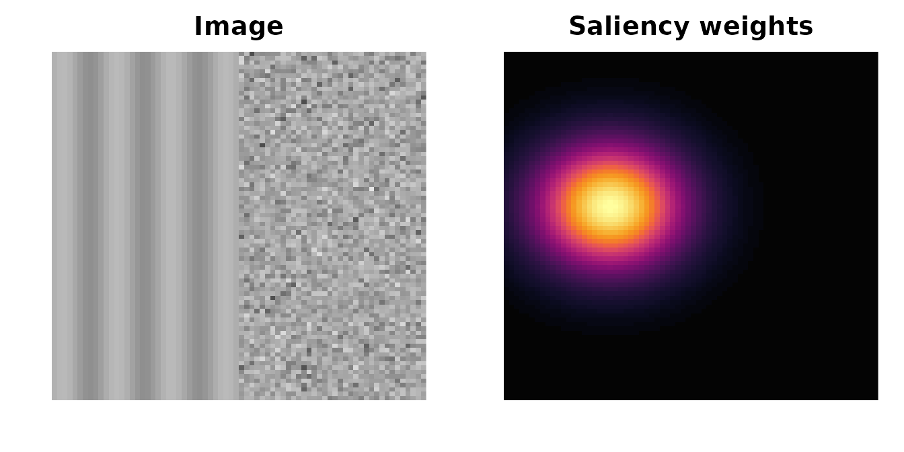
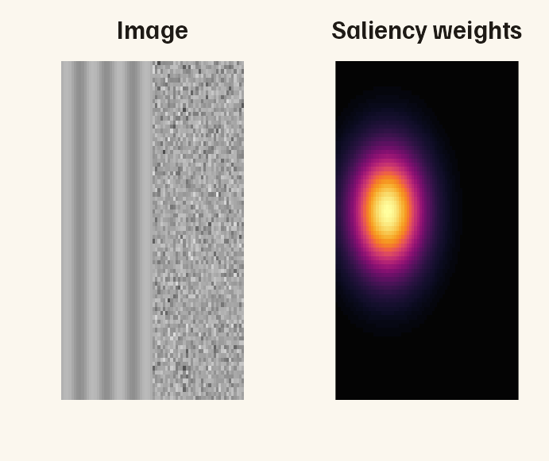
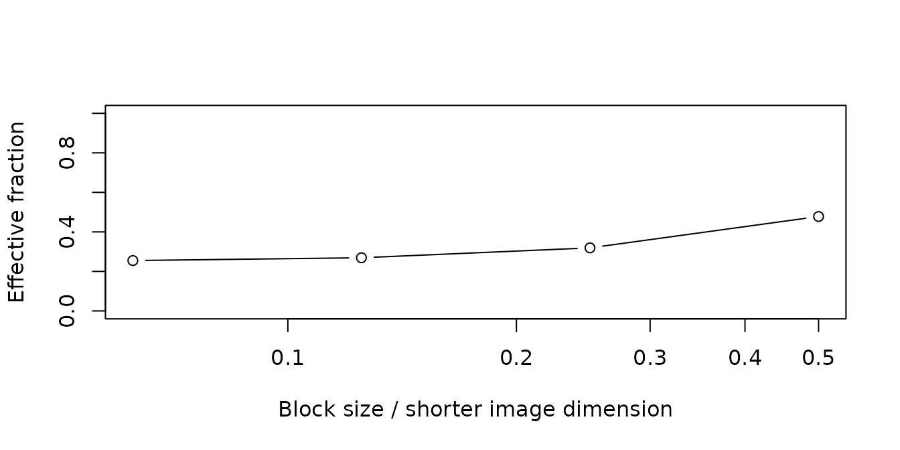
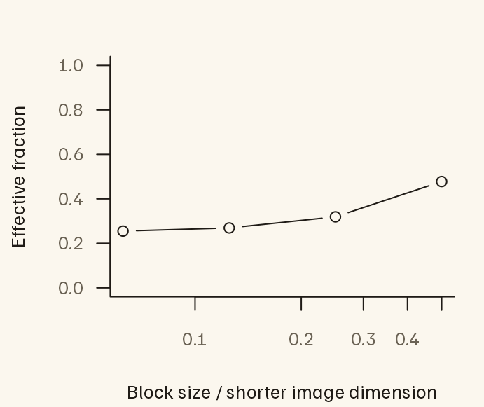

# Measuring image structure with saliency maps

An image can contain very different kinds of structure in different
places. Think of regular stripes on one side and a patch of visual noise
on the other. A measurement of the whole image combines information from
both regions. What if you want the measurement to give more importance
to one region?

A **saliency map** supplies a weight for each location in the image. It
is often shown as a heat map: brighter locations receive more weight.
The values might come from a model that predicts where people will look,
or from a region you have chosen to study. Here we will construct a
simple map ourselves, so we know exactly which part of the image it
emphasizes.

The package uses **entropy** to summarize how spread out a distribution
is. For edge orientations, low entropy means that a few orientations
account for most of the edge strength; higher entropy means that
strength is spread more evenly across orientations. Regular stripes and
visual noise therefore provide a useful first example.

[`compute_saliency_features()`](https://bbuchsbaum.github.io/imfeatures/reference/compute_saliency_features.md)
returns three kinds of measurements:

- **First-order edge entropy:** how varied are the edge orientations in
  the regions receiving weight? This pools orientations across
  locations.
- **Pairwise (second-order) edge entropy:** how varied are the
  orientation relationships between edges at particular distances and
  directions from one another? This also takes their spatial arrangement
  into account.
- **Location entropy:** how concentrated is the heat map itself? A small
  bright spot concentrates weight in a small area; a broadly spread map
  distributes it over more of the image.

The distinction matters because the same bright spot can fall on either
stripes or noise. Moving that spot preserves the map’s concentration but
changes which image features receive weight. We will use this idea to
interpret the results.

## Build an example we can recognize by eye

We will put vertical stripes on the left and random noise on the right,
then place the heat map’s bright spot over the stripes. Later, we will
flip the map so that it emphasizes the noise. We expect the stripes to
have lower first-order edge entropy because their edges occupy fewer
orientations.

The code below creates two matrices: `img` holds the image values and
`saliency` holds the weights. Each weight belongs to the pixel at the
same position in `img`.

``` r

set.seed(104)
img <- outer(1:72, 1:80, function(x, y) sin(x * .6))
img[37:72, ] <- matrix(rnorm(36 * 80), 36, 80)
saliency <- outer(1:72, 1:80, function(x, y)
  exp(-((x - 21)^2 + (y - 45)^2) / 180))
```



In the figure, brighter colors in the heat map mean that those parts of
the image will contribute more to the weighted edge measurements. For
your own data, check that the image and map have the same dimensions and
orientation, and cover the same area. A bright spot should sit over the
feature you intend to emphasize. With imager’s matrix convention, the
first dimension runs horizontally. If you supply an image file, supply a
map on that file’s original pixel grid; the function will resize them
together if needed.

## Measure the image with and without the heat map

The function first detects edges in the image, then uses the map to
weight their contribution. Start by comparing three rows in its output:

- `observed` uses the map we supplied, with its bright spot over the
  stripes.
- `unweighted` gives every location the same saliency weight. Stronger
  image edges still contribute more than weaker ones.
- `flip_axis1` flips the supplied map horizontally, moving the bright
  spot onto the noise while leaving the image unchanged.

The function also returns other comparison maps, which we will explain
below. We use smaller filters and distance ranges to suit this small
example. The `ranges` entries specify inclusive histogram indices: index
1 represents rounded distance zero, so indices 5 through 20 represent
rounded distances 4 through 19 pixels. Keep pixel scale and viewing
geometry consistent when comparing different images.

``` r

settings <- list(filter_length = 9L, gabor_bins = 8L, circ_bins = 16L,
                 maxdiag = 100L,
                 ranges = list(c(5L, 20L), c(21L, 40L), c(41L, 70L)))
elapsed <- system.time(
  result <- do.call(compute_saliency_features, c(
    list(image = img, saliency = saliency, representation = "weights",
         centre_match = TRUE, scales = c(1/16, 1/8, 1/4, 1/2)), settings))
)[["elapsed"]]
result$features[
  result$features$control %in% c("observed", "unweighted", "flip_axis1"),
  c("control", "first_order", "effective_fraction")
]
#>      control first_order effective_fraction
#> 1   observed    1.155534          0.2516846
#> 2 unweighted    2.180706          1.0000000
#> 5 flip_axis1    2.942213          0.2516846
```

With the heat map over the stripes, first-order entropy is 1.156 bits.
Flipping the map onto the noise raises it to 2.942 bits. The measurement
is responding to the part of the image we emphasized, as intended.
Because we made this map ourselves, this example tells us about the
weighting calculation; it does not tell us where a person would actually
look.

The `effective_fraction` column describes the map’s concentration on a
scale from a single pixel’s fraction of the image up to 1. A uniform map
has a value of 1. Our map has a value of 0.252: it has the same location
entropy as distributing weight equally over approximately 25% of the
image. This is a summary of the whole weight distribution, rather than
an area obtained by drawing a boundary around the bright spot. Flipping
the map preserves this value.

## Choose the representation and selection rule

Use `representation = "weights"` for nonnegative maps and
`"log_density"` for natural-log density outputs. Log values can be
negative; `-Inf` means zero mass. The package exponentiates stably and
normalizes the map. Multiplying raw weights by a positive constant, or
adding a constant to log densities, leaves results unchanged.

``` r

raw_location <- saliency_location_entropy(saliency, "weights")
log_location <- saliency_location_entropy(log(saliency) - 1000, "log_density")
stopifnot(isTRUE(all.equal(raw_location, log_location, tolerance = 1e-10)))
raw_location
#>   H_location KL_uniform effective_fraction status
#> 1   10.50154   1.990311          0.2516846     ok
```

Signed raw maps are rejected by default. `signed_policy = "rectify"`
replaces negative weights with zero; `"shift"` subtracts a negative
minimum. Choose and record a policy appropriate to the model: these
choices change its map, and neither turns arbitrary model scores into
calibrated fixation probabilities. Zero-mass maps return NA with a
status, rather than a uniform fallback.

``` r

saliency_location_entropy(matrix(c(-1, 0, 1, 2), 2), "weights",
                          signed_policy = "rectify")
#>   H_location KL_uniform effective_fraction status
#> 1  0.9182958   1.081704          0.4724704     ok
```

The edge filters assign each location a strength, called its
**response**, and an orientation. First-order entropy uses all positive
responses. Pairwise entropy uses a subset of edges to keep computation
manageable. The default `edge_selection = "image"` selects them by
response strength, then uses exactly those edges for every comparison
map. This isolates reweighting. The legacy selection threshold retains
the strongest 10,000 responses on larger images, including cutoff ties;
below 10,000 pixels it uses the strongest 10% instead. It is not an
exact cap when responses tie.

`edge_selection = "saliency"` selects by response times saliency, so
low-contrast salient edges can enter. It measures the combined effect of
selection and weighting and may require separate counting passes for
different controls.

``` r

sensitivity <- do.call(compute_saliency_features, c(
  list(image = img, saliency = saliency, representation = "weights",
       edge_selection = "saliency", pair_weighting = "reference",
       transform_controls = FALSE), settings))
selected <- sensitivity$selection[c("observed", "unweighted")]
data.frame(control = names(selected),
           selected_edges = vapply(selected, nrow, integer(1)))
#>               control selected_edges
#> observed     observed            576
#> unweighted unweighted            595
```

The default `pair_weighting = "both"` weights both endpoints of each
ordered pair. `"reference"` weights only the reference endpoint: it asks
about structure around salient reference edges, including nonsalient
endpoints. Neither mode filters a saliency-multiplied image.

## Compare the original map with alternatives

To understand a weighted result, keep the image fixed and change the
map. These alternative maps are **controls**: they help you ask what
accounts for a difference in entropy. Alongside the unweighted image,
the function provides:

- **A centre map**, labelled `centre_bias`, which puts more weight near
  the middle of the image regardless of its content.
- **Flipped or rotated versions of the supplied map**, which preserve
  its weight values but move them relative to image features. The
  earlier `flip_axis1` comparison is one example.
- **Maps borrowed from other images**, when you supply them. The API
  calls each borrowed map a **donor map**. This lets you compare the
  image’s own saliency map with maps associated with other images,
  without breaking those maps into randomly shuffled pixels.

Weighting changes the descriptor. It can increase or decrease entropy: a
concentrated map may emphasize regular structure, diverse structure, or
weak edges that counterbalance already uneven response strengths. The
unweighted contrast describes the **overall effect of weighting**. Exact
map transforms preserve the saliency value distribution and help examine
alignment with this particular image. Their overlap with image edges and
their pair support can still change.

Here, **alignment** means where the map’s high weights fall relative to
image features. In our example, the bright spot’s alignment with stripes
rather than noise explains why moving it changes first-order entropy.

The following values were supplied in the feature review. They are an
illustration for interpreting contrasts, not measurements from the
synthetic image above or a benchmark of the revised implementation.

| control     | effective_fraction | 20-80 | 80-160 | 160-240 |
|:------------|-------------------:|------:|-------:|--------:|
| unweighted  |               1.00 | 4.489 |  4.443 |   4.399 |
| centre_bias |               0.78 | 4.459 |  4.370 |   4.375 |
| flip_axis1  |               0.34 | 4.414 |  4.262 |   4.234 |
| observed    |               0.34 | 4.292 |  4.239 |   4.247 |

Illustrative review values; entropy in bits {.table}

|                           |  20-80 | 80-160 | 160-240 |
|:--------------------------|-------:|-------:|--------:|
| Observed minus unweighted | -0.197 | -0.204 |  -0.152 |
| Observed minus flipped    | -0.122 | -0.023 |   0.013 |

All three observed-minus-unweighted values are negative. Against the
flipped map, the additional reduction is mainly short-range; the
long-range difference is slightly positive. This one example does not
establish a general effect. Moreover, those raw summaries may average
different combinations of distances and directions. Each such
combination is called a **cell**. A cell is left out if it has too
little weighted edge-pair support under the chosen validity rule.

To compare the same cells, we can restrict both maps’ calculations to
the cells that are available for both. This is called **common
support**. The output includes this comparison alongside the original
difference:

``` r

result$ranges[result$ranges$control == "flip_axis1",
  c("start", "end", "observed_minus_control", "observed_minus_control_common",
    "common_valid_cell_coverage", "common_status")]
#>    start end observed_minus_control observed_minus_control_common
#> 13     5  20             0.01714162                    0.01714162
#> 14    21  40             0.20877953                    0.20877953
#> 15    41  70             0.17956417                    0.20440138
#>    common_valid_cell_coverage common_status
#> 13                  0.8007812            ok
#> 14                  0.7343750            ok
#> 15                  0.2750000            ok
```

`observed_minus_control_common` intersects the two maps’ valid cells
before averaging. Both maps use equal weight for shared directions at
each distance, then equal weight for retained distances.
`common_valid_cell_coverage` records how much of the range survived this
intersection.

The signs of first-order and pairwise contrasts differ in this
constructed example. These measures describe different distributions:
marginal orientations versus relative orientations conditional on
distance and direction. There is no requirement that weighting move them
together.

The output also summarizes controls in two groups, called **families**:
flipped or rotated maps (`transformed`), and maps from other images
(`donor`). Within each group, it keeps cells available for the observed
map and **all usable distinct comparison maps**. This is more
restrictive than comparing two maps at a time. A transformation that
leaves the map unchanged is excluded, and repeated copies of the same
map receive no extra votes. The mean and SD describe the control values;
the SD is not a standard error or a permutation-test uncertainty
estimate.

``` r

result$comparisons[, c("family", "metric", "range_id", "observed_minus_control_mean",
                       "n_controls", "common_valid_cell_coverage", "status")]
#>        family      metric range_id observed_minus_control_mean n_controls
#> 1 transformed first_order       NA                 -1.20753631          3
#> 2 transformed    pairwise        1                  0.01142794          3
#> 3 transformed    pairwise        2                  0.13921054          3
#> 4 transformed    pairwise        3                  0.13665808          3
#> 5       donor first_order       NA                          NA          0
#> 6       donor    pairwise        1                          NA          0
#> 7       donor    pairwise        2                          NA          0
#> 8       donor    pairwise        3                          NA          0
#>   common_valid_cell_coverage               status
#> 1                         NA                   ok
#> 2                  0.8007812                   ok
#> 3                  0.7343750                   ok
#> 4                  0.2750000                   ok
#> 5                         NA no_distinct_controls
#> 6                         NA no_distinct_controls
#> 7                         NA no_distinct_controls
#> 8                         NA no_distinct_controls
```

The observed rows of `features` and `ranges` also contain
`observed_minus_transform_mean` and `observed_minus_donor_mean`. The
pairwise versions always use the family-wide common support. Other
control rows have NA in these columns. Because we have not yet supplied
maps from other images, that group’s summary is unavailable. We add them
in the next section.

The fixed `centre_bias` map uses `centre_sigma = .25`. With
`centre_match = TRUE`, a second map, `centre_bias_matched`, fits an
isotropic Gaussian in normalized image coordinates to the observed
effective fraction. Matching this one entropy value does not match
shape, multimodality, edge overlap or pair support. The fit can be
unattainable on a discrete grid, for example a one-pixel point mass
versus a centred Gaussian on an even-by-even grid. Inspect the fit
status and achieved fraction rather than assuming success.

``` r

result$metadata$controls$centre_bias_matched
#> $source
#> [1] "effective-fraction-matched centred Gaussian"
#> 
#> $sigma_image_fraction
#> [1] 0.1214382 0.1214382
#> 
#> $target_effective_fraction
#> [1] 0.2516846
#> 
#> $achieved_effective_fraction
#> [1] 0.2516846
#> 
#> $minimum_effective_fraction
#> [1] 0.0006944444
#> 
#> $fit_status
#> [1] "ok"
```

## Add comparison maps from other images

For a collection of images, you can ask whether each image’s own
saliency map produces a different result from maps associated with the
other images. First, choose which images are suitable comparisons: they
should have compatible aspect ratios and maps produced by the same model
and preprocessing steps.
[`saliency_donor_assignments()`](https://bbuchsbaum.github.io/imfeatures/reference/saliency_donor_assignments.md)
then chooses which other image’s map to use for each target image.

The `strata` argument expresses these matching groups: only images with
the same group label can exchange maps. This does not automatically
match map concentration. Add concentration to your grouping rule if your
study requires it, and inspect the effective fractions after any
resizing. A borrowed map retains its own pattern of weights, which may
be more or less concentrated than the target image’s map.

Here we create synthetic stand-ins for two other images’ maps. We label
all three images as belonging to the same matching group and request two
sets of assignments with `replicates = 2L`.

``` r

other_maps <- list(
  other_a = outer(1:72, 1:80, function(x, y) exp(-((x-55)^2+(y-30)^2)/180)),
  other_b = outer(1:72, 1:80, function(x, y) exp(-((x-40)^2+(y-65)^2)/350))
)
assignments <- saliency_donor_assignments(
  c("scene", "other_a", "other_b"), rep("same-grid-model-processing", 3),
  replicates = 2L, seed = 7L
)
with_other_maps <- do.call(compute_saliency_features, c(
  list(image = img, saliency = saliency, representation = "weights",
       image_id = "scene", donor_maps = other_maps, donor_assignments = assignments),
  settings))
with_other_maps$comparisons[with_other_maps$comparisons$family == "donor",
  c("metric", "range_id", "n_requested", "n_controls", "controls_used",
    "observed_minus_control_mean", "status")]
#>        metric range_id n_requested n_controls controls_used
#> 5 first_order       NA           2          1       donor_1
#> 6    pairwise        1           2          1       donor_1
#> 7    pairwise        2           2          1       donor_1
#> 8    pairwise        3           2          1       donor_1
#>   observed_minus_control_mean status
#> 5                -1.197543536     ok
#> 6                 0.004883084     ok
#> 7                 0.032150841     ok
#> 8                 0.037126086     ok
```

Assignments exclude the same stimulus, including alternate versions
identified with `stimulus_ids`. Random-number state is restored.
Randomized matching does not sample all admissible permutations
uniformly, so these are descriptive controls, not calibrated permutation
p-values.

Keep these summaries separate from those for flipped or rotated maps.
Combining them into one mean would make the result depend on how many
assignments from other images you requested. The output reports
`n_requested` and `n_controls` separately because repeated assignments
can reuse a map; each distinct map receives one vote in the summary.

## Inspect support and resizing

``` r

result$ranges[result$ranges$control == "observed",
  c("start", "end", "entropy", "mass_fraction", "effective_pairs_ratio",
    "valid_cell_coverage", "status")]
#>   start end    entropy mass_fraction effective_pairs_ratio valid_cell_coverage
#> 1     5  20 0.04793208   0.713984103             0.3009317           0.8007812
#> 2    21  40 0.62159347   0.232886490             0.2760750           0.7343750
#> 3    41  70 0.89022701   0.004215989             0.2430160           0.3458333
#>   status
#> 1     ok
#> 2     ok
#> 3     ok
```

`effective_pairs_ratio` compares Kish effective counts with the
unweighted counts on the **same selected edges**. A value of 0.22
describes a reduction in weight spread relative to that baseline, not
retention of 22% of independent observations. Pairs share endpoints.
Effective count is not an upper bound on categorical entropy and is not
an automatic bias correction.

Low `valid_cell_coverage` means the summary represents only part of its
nominal range. Inspect `result$cells$observed` to find which cells are
missing or have concentrated weights. Compact hotspots can leave long
ranges unavailable even when some positive mass reaches those distances.
NA is distinct from a valid entropy of zero. `validity = "support"`
requires explicit `min_cell_mass_fraction` and `min_effective_pairs`;
these replace the legacy mass cutoff. `min_common_coverage` can
additionally reject comparisons with too little shared coverage. Its
default zero requires at least one shared cell and does not certify
adequate support for a scientific interpretation.

Both backends of this new API use Euclidean geometry and the native
legacy validity rule. The historical R conventions remain in
`compute_edge_entropy(use_cpp = FALSE)`. Uniform saliency retains native
legacy results; ordinary numerical tolerance applies to comparisons
between backends.

Map downsampling uses area averaging, upsampling uses linear
interpolation, and mass is renormalized afterward. These operations can
change concentration. Metadata for the supplied map and maps from other
images record location metrics before and after resizing. For maps from
other images, the default aspect-ratio tolerance is 1%, intended for
small grid-rounding differences, not for accepting a different field of
view. Keep smoothing and viewing geometry consistent across images;
record model and smoothing details with `provenance`. No additional
smoothing is applied here.

## Examine spatial organization at several scales

``` r

curve <- result$multiscale$observed$summary
plot(curve$scale, curve$effective_fraction, type = "b", log = "x",
     xlab = "Block size / shorter image dimension",
     ylab = "Effective fraction", ylim = c(0, 1))
```



The curve aggregates probability into blocks at several shifted grid
origins. Boundary blocks use their actual areas in the uniform
reference. Inspect `result$multiscale$observed$curve` for individual
origins. This is multiscale location entropy, not second-order entropy;
it describes clustering without uniquely identifying the number or
arrangement of hotspots. Use degrees of visual angle with
`scale_units = "degrees"` and `pixels_per_degree` when that calibration
is available. Arbitrary resampling and smoothing are not invariances.

## Plan runtime

The main example above took 0.730 seconds in this build. It uses a
72-by-80 image and reduced filters and bins, so this is not a prediction
for full-size stimuli. Pairwise work grows quadratically with the number
of selected edges and roughly linearly with the number of controls after
sharing geometry. Default image selection shares one geometry pass and
one unweighted baseline across controls. Saliency-based selection may
require separate passes, and ties can increase the selected edge count
above 10,000.

Use `pairwise = FALSE` for first-order and map descriptors alone.
Benchmark a representative image with
[`system.time()`](https://rdrr.io/r/base/system.time.html) before
processing a corpus; record image dimensions, selected edge counts,
controls, bins and backend. The R backend provides a slower reference
implementation. Neither a smoke test nor this small runnable example
establishes production throughput.
